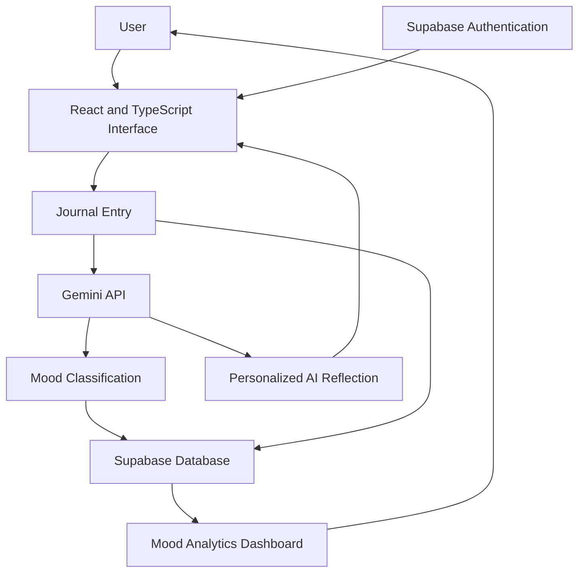

# MindFrame – AI-Powered Mood Journal

> Understand your emotions. Discover your patterns. Reflect with AI.


## Overview

MindFrame is a full-stack, AI-powered mood journaling and emotional wellness application designed to help individuals understand, track, and reflect on their emotional experiences.

Unlike traditional journaling platforms that simply store written thoughts, MindFrame leverages Google's Gemini API to interpret journal entries, identify emotional patterns, and generate personalized reflections based on the user's experiences.

The platform combines generative AI, natural language understanding, data visualization, and persistent database storage to create an interactive and personalized journaling experience.

## Problem Statement

Traditional journaling methods provide an effective way to express emotions but often lack mechanisms for understanding recurring emotional patterns.

Users may face challenges such as:

- Difficulty identifying and articulating emotions.
- Limited awareness of long-term mood patterns.
- Lack of personalized feedback on journal entries.
- Difficulty maintaining consistent self-reflection.
- Fragmented emotional wellness tracking.

MindFrame addresses these challenges by transforming passive journaling into an interactive, AI-assisted self-reflection experience.

## Proposed Solution

MindFrame integrates generative AI with digital journaling to analyze emotional context from natural language inputs.

The application allows users to document their thoughts, receive personalized AI-generated reflections, and visualize their emotional trends over time.

By combining qualitative journal entries with structured mood information, MindFrame encourages greater emotional awareness and meaningful self-reflection.

## Key Features

### 1. Intelligent Mood Journaling

- Write and record daily thoughts and experiences.
- Express emotions through natural language without being limited to predefined responses.
- Maintain a persistent history of journal entries.

### 2. AI-Powered Emotion Analysis

- Analyzes journal entries using Google's Gemini API.
- Identifies the emotional tone of user-generated text.
- Converts unstructured journal entries into meaningful mood classifications.
- Uses prompt engineering to guide AI-generated responses.

### 3. Personalized AI Reflections

- Generates contextual reflections based on individual journal entries.
- Encourages users to explore their thoughts and emotions.
- Provides personalized responses rather than static, predefined messages.
- Supports a reflective and non-judgmental journaling experience.

### 4. Mood Analytics Dashboard

- Visualizes emotional trends over time.
- Provides weekly, monthly, and all-time mood tracking.
- Helps users identify recurring emotional patterns.
- Transforms historical mood information into accessible visual insights.

### 5. User Authentication and Data Persistence

- Supabase-powered authentication and database integration.
- Persistent storage of journal entries and mood information.
- User-specific journal history.

### 6. Responsive User Interface

- Modern and intuitive interface.
- Responsive design across different screen sizes.
- Clean and minimal layout focused on usability.

## Technology Stack

| Category | Technology |
|---|---|
| Frontend Framework | React |
| Programming Language | TypeScript |
| UI Styling | Tailwind CSS |
| Generative AI | Google Gemini API |
| AI Technique | Prompt Engineering |
| Backend | Supabase |
| Database | PostgreSQL |
| Authentication | Supabase Auth |
| Build Tool | Vite |
| Development Platform | Bolt AI |
| Version Control | Git and GitHub |

## System Architecture



The application integrates three primary layers:

### Presentation Layer

The React and TypeScript frontend handles user interactions, journal entry submission, AI response presentation, and mood trend visualization.

### AI Processing Layer

Google's Gemini API processes natural language journal entries to identify emotional context and generate personalized reflections.

### Data Management Layer

Supabase provides authentication and PostgreSQL-based persistent storage for journal and mood-related information.

## AI Integration

MindFrame uses a pretrained generative AI model through Google's Gemini API rather than training a machine learning model from scratch.

The AI integration focuses on two primary tasks:

### Mood Classification

The model interprets the emotional context of journal entries and generates a corresponding mood classification.

### Context-Aware Reflection Generation

The model generates a personalized reflection based on the user's written experiences, encouraging thoughtful self-reflection.

Prompt engineering is used to guide the model toward relevant, empathetic, and context-aware responses.

## AI Processing Workflow

1. The user writes and submits a journal entry.
2. The journal text is provided to Gemini through an engineered prompt.
3. Gemini interprets the emotional context of the entry.
4. The model generates a mood classification and personalized reflection.
5. Journal and mood information are stored using Supabase.
6. Historical mood data is retrieved for visualization.
7. The dashboard presents emotional trends across different time periods.

## Core Technical Concepts

- Generative Artificial Intelligence
- Natural Language Processing
- Large Language Model Integration
- Prompt Engineering
- Context-Aware Text Generation
- Emotion Classification
- REST API Integration
- Database Management
- User Authentication
- Data Visualization
- Responsive Web Development

## Project Structure

```text
MindFrame-mood-journal/
│
├── .bolt/
├── .github/
│   └── workflows/
├── src/
├── supabase/
├── .gitignore
├── eslint.config.js
├── index.html
├── package.json
├── package-lock.json
├── postcss.config.js
├── tailwind.config.js
├── tsconfig.app.json
├── tsconfig.json
├── tsconfig.node.json
├── vite.config.ts
└── README.md
```

| Directory / File | Purpose |
|---|---|
| `src/` | Frontend application source code |
| `supabase/` | Supabase-related backend configuration |
| `.github/workflows/` | GitHub workflow configuration |
| `.bolt/` | Bolt development configuration |
| `package.json` | Project dependencies and scripts |
| `tailwind.config.js` | Styling configuration |
| `vite.config.ts` | Vite build configuration |
| `tsconfig.json` | TypeScript configuration |

## Installation and Setup

### Prerequisites

Ensure the following are available:

- Node.js
- npm
- Git
- Google Gemini API credentials
- Supabase project and credentials

### Step 1: Clone the Repository

```bash
git clone https://github.com/Architha1713/MindFrame-mood-journal.git
```

### Step 2: Navigate to the Project Directory

```bash
cd MindFrame-mood-journal
```

### Step 3: Install Dependencies

```bash
npm install
```

### Step 4: Configure Environment Variables

Create a `.env` file in the project root and configure the required Supabase and Gemini credentials according to the application's source code.

Required configuration includes:

- Supabase project URL
- Supabase public client key
- Gemini API credentials

Never commit private API keys or service-role credentials to GitHub. Sensitive credentials should be managed through a secure server-side environment.

### Step 5: Start the Development Server

```bash
npm run dev
```

Open the local URL displayed in the terminal to access the application.

## Application Screenshots

Screenshots of the application's interface, journaling functionality, AI-generated reflections, and mood analytics dashboard will be added here.

## Potential Use Cases

- Daily personal journaling
- Emotional awareness and self-reflection
- Personal mood tracking
- Identifying recurring emotional patterns
- Developing consistent reflective habits
- AI-assisted personal wellness journaling

## Challenges and Learnings

### Prompt Engineering

Designing prompts that produce relevant emotional classifications and meaningful reflections demonstrates the importance of prompt structure, context, and instructions in LLM-based applications.

### Generative AI Integration

Integrating Gemini into a full-stack application provides practical experience in connecting language models with real-world user interactions.

### Data Persistence

Managing journal entries and historical mood information through Supabase demonstrates the importance of structured storage for personalized applications.

### Data Visualization

Transforming individual mood classifications into historical trends makes AI-generated information more accessible and useful.

### User-Centered Design

Developing an emotional wellness application requires careful consideration of accessibility, simplicity, response tone, and user experience.

## Responsible AI and Privacy Considerations

Journal entries may contain sensitive personal information. Responsible development of MindFrame requires attention to:

- Secure handling of user credentials.
- Appropriate database access controls.
- Transparency regarding AI processing of journal entries.
- Protection of sensitive personal information.
- Non-judgmental AI-generated responses.
- Limitations of automated emotional interpretation.

AI-generated responses may not always accurately represent a user's emotional state and should be treated as reflective suggestions rather than definitive assessments.

## Limitations

- AI-generated mood classifications may misinterpret complex or ambiguous emotions.
- Response quality depends on the journal input and prompt design.
- AI functionality depends on external API availability.
- The application is not a clinically validated mental health assessment tool.

## Future Enhancements

- PDF export of mood history and reports.
- Journaling streaks and habit tracking.
- AI-generated weekly and monthly emotional summaries.
- Personalized journaling prompts.
- Multilingual journal analysis.
- Voice-based journaling with speech-to-text integration.
- Mood-based music and activity recommendations.
- Advanced emotional pattern recognition.
- Enhanced privacy and data management controls.
- Evaluation of AI-generated mood classifications and reflections.

## Project Objectives

MindFrame demonstrates the practical application of generative AI in a user-centered wellness product.

The project explores how large language models can be integrated with conventional full-stack development to transform unstructured human input into meaningful insights and personalized digital experiences.

## Disclaimer

MindFrame is designed for personal journaling, emotional awareness, and self-reflection.

It is not intended to diagnose, treat, or prevent mental health conditions and should not be considered a substitute for qualified mental health professionals.

## Author

**Architha B C**

B.E. – Artificial Intelligence and Machine Learning  
The Oxford College of Engineering, Bengaluru, India

**Areas of Interest:** Artificial Intelligence, Machine Learning, Generative AI, AI Product Development and Research.

[GitHub Profile](https://github.com/Architha1713)

---

*Built to explore the intersection of artificial intelligence, human emotions, and meaningful digital experiences.*
